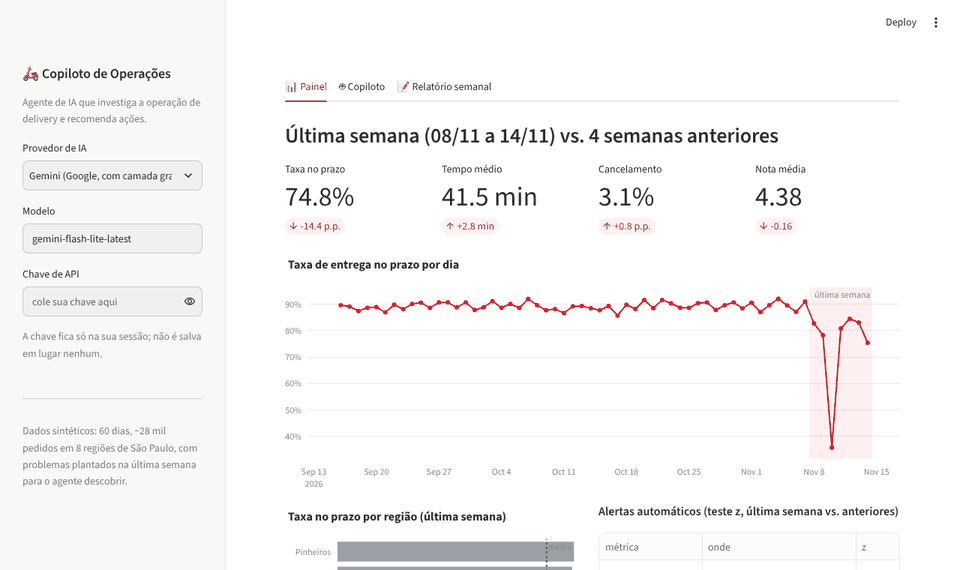
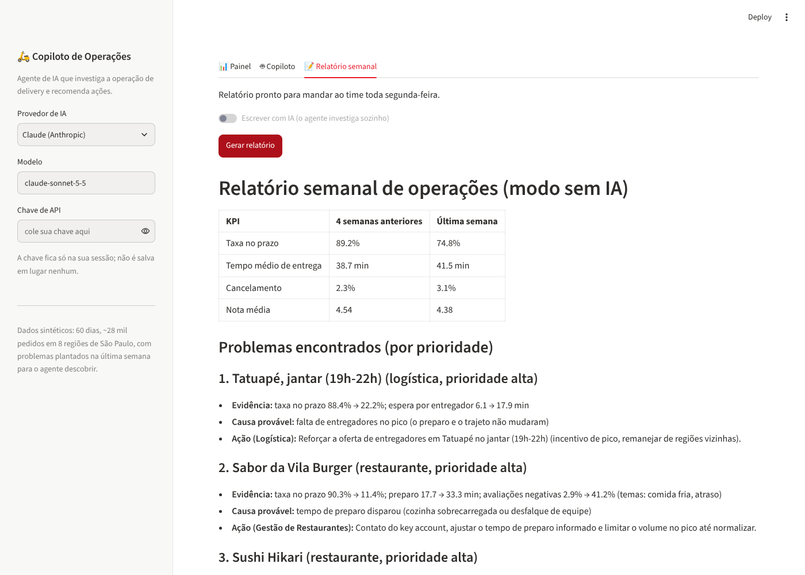
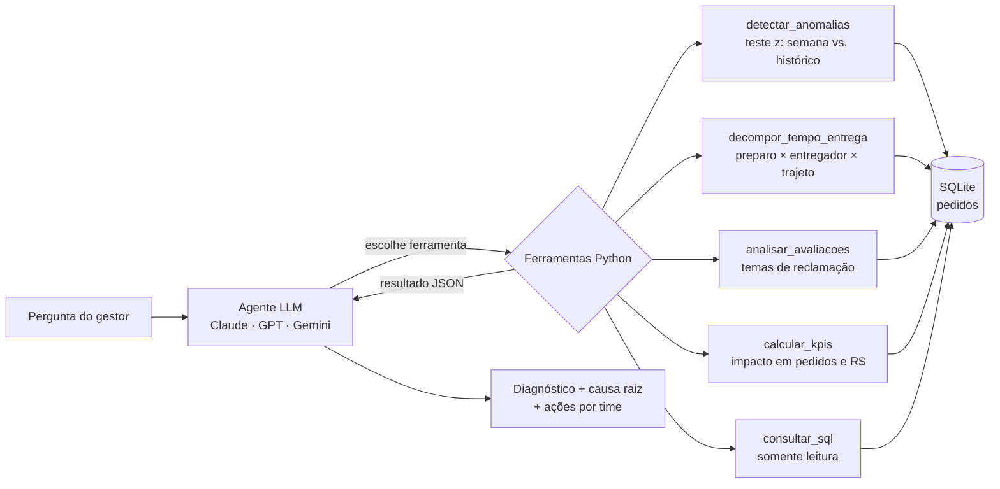

# 🛵 Copiloto de Operações de Delivery

**Um agente de IA que investiga a operação de delivery como um analista sênior faria:** ele descobre o que piorou, separa causa de restaurante, de logística e de evento externo, traz a voz do cliente e recomenda ações por time, sempre com números tirados dos dados, nunca inventados.

> 🔗 **[Abrir a demo online](https://copiloto-ops-delivery.streamlit.app)** &nbsp;·&nbsp; ✅ testes automatizados no GitHub Actions &nbsp;·&nbsp; 🧠 funciona com Claude, GPT ou Gemini &nbsp;·&nbsp; 🔎 verifica os próprios números



### Resultado em uma execução real

Pergunta: *"O que piorou na última semana e onde devo agir primeiro?"*, com o Gemini Flash-Lite:

| | |
|---|---|
| Problemas plantados encontrados | **4 de 4** |
| Ferramentas chamadas | 17 (em ~88 s) |
| Números da resposta conferidos com os dados | **25 de 25** (verificação automática) |

Essa execução fica gravada no app: quem não tem chave de API pode clicar em **"Ver uma execução real do agente"** e acompanhar a investigação passo a passo. As ferramentas rodam de verdade; só a resposta do modelo é reproduzida.

---

## O problema

Na operação de delivery, a pergunta de toda segunda-feira é: **"o que deu errado na semana e onde eu ajo primeiro?"**

Um dashboard mostra *onde* um indicador caiu, mas não mostra *por quê*. Descobrir o porquê exige cruzar várias coisas: tempo de preparo, espera por entregador, trajeto, cancelamentos e avaliações. Um analista leva horas nisso, e o agente faz a mesma investigação em segundos.

Construí este projeto a partir da minha experiência em **Supply Chain na Sanofi**, onde desenvolvi o dashboard de **OTIF (On Time In Full)** usado por várias áreas para direcionar ações corretivas na logística. Aqui levei a mesma lógica para delivery: *taxa de entrega no prazo* é o OTIF do iFood.

## O que o agente descobre sozinho

A base sintética (60 dias, ~28 mil pedidos, 8 regiões de São Paulo) tem **4 problemas plantados** na última semana. O agente precisa encontrá-los **e diferenciar as causas**:

| Problema plantado | O que o agente precisa perceber |
|---|---|
| 🍔 Um restaurante com a cozinha sobrecarregada | O atraso está no **preparo**, não no entregador. As avaliações falam em "comida fria". |
| 🛵 Uma região sem entregadores no jantar | Vários restaurantes da mesma região pioram juntos, então o problema é da **região** (espera por entregador), não dos restaurantes. |
| 🍣 Um restaurante com ruptura de estoque | Os cancelamentos sobem e 97% deles são por **item indisponível**. |
| 🌧️ Um dia de chuva | Todas as regiões caem no mesmo dia: é um **evento externo**. Esse dia precisa ser excluído para não gerar falsos alarmes. |

O ponto difícil é o último: sem excluir o dia de chuva, a detecção acusa vários restaurantes que não têm problema nenhum. O agente aprende (pelo prompt) a isolar esse dia antes de procurar problemas estruturais.



## Como funciona



**Decisões de design:**

- **O LLM decide, o Python calcula.** Todo número vem de uma função determinística e testada. O modelo só escolhe as ferramentas e interpreta os resultados, o que reduz alucinação de números.
- **Auditável.** A interface mostra cada ferramenta chamada, com os argumentos e o resultado ("Como cheguei nisso"). Um gestor consegue conferir o raciocínio.
- **Seguro.** O SQL é somente leitura, com dupla proteção: validação do comando + conexão SQLite em modo `ro`. Pedidos como "apague os cancelados" são recusados.
- **Multi-provedor.** O mesmo loop de agente funciona com a API nativa da Anthropic (Claude) e com qualquer API compatível com OpenAI (GPT, Gemini, Groq, OpenRouter, Ollama).
- **Funciona sem chave de API.** O painel e o relatório semanal em "modo sem IA" rodam offline. Esse modo também serve de *baseline* para comparar com o agente.
- **Verifica os próprios números.** Depois de cada resposta, um verificador extrai todos os números (percentuais, R$, minutos, z-scores) e procura cada um nos resultados das ferramentas. O que não for encontrado é sinalizado para revisão: pode ser uma conta feita pelo modelo ou uma alucinação. Na execução real acima, 25 de 25 conferiram, e o teste automatizado confirma que números adulterados são pegos.
- **Limite de passos.** O agente tem no máximo 10 chamadas de ferramenta por pergunta, para não entrar em loop nem gastar tokens à toa.

## Qualidade: testes e avaliações

**Testes (`pytest`, 30 testes, rodam no CI a cada push):**
- as ferramentas encontram cada um dos 4 problemas plantados;
- a decomposição aponta a causa certa (preparo × entregador);
- o relatório offline encontra **exatamente 4 problemas, sem falsos positivos**;
- o SQL bloqueia `DROP`, `DELETE`, `UPDATE`, múltiplos comandos etc.;
- o loop do agente é testado com um **LLM simulado** (executa ferramentas, se recupera de erros e respeita o limite de passos);
- o verificador de números aprova a execução real gravada e **pega números adulterados**;
- os schemas das ferramentas são compatíveis com as restrições do Gemini (sem `properties` vazio nem `default`), e campos extras do provedor, como a *thought signature*, são preservados entre chamadas.

**Evals do agente (`evals/`):** 6 perguntas reais com critérios automáticos. A resposta precisa citar as conclusões certas, não pode citar as erradas e tem que ter usado as ferramentas (ou seja, buscado o dado em vez de chutar). Cada resposta também passa pelo verificador de números, e o relatório final mostra quantos números estavam fundamentados nos dados.

```bash
python -m evals.rodar_evals --provedor gemini
```

## Rodando localmente

```bash
git clone https://github.com/Wide2357/copiloto-ops-delivery
cd copiloto-ops-delivery
pip install -r requirements.txt
streamlit run app.py          # a base de dados é gerada sozinha na primeira execução
```

Para conversar com o agente, cole uma chave de API na barra lateral ou crie um `.env` a partir do `.env.example`. **Dica:** o Gemini tem camada gratuita em [aistudio.google.com/apikey](https://aistudio.google.com/apikey).

```bash
python -m copiloto.testar --provedor gemini --chave SUA_CHAVE   # teste rápido com um LLM real
pytest -q                      # testes
python -m copiloto.relatorio   # relatório semanal no terminal, sem IA
```

## Estrutura

```
copiloto/
  dados.py        # gerador de dados sintéticos com problemas plantados (seed fixa)
  ferramentas.py  # as 6 ferramentas + schemas JSON + SQL seguro
  agente.py       # loop de tool calling multi-provedor (Anthropic / OpenAI-compatível)
  prompts.py      # system prompt: método de investigação e formato da resposta
  relatorio.py    # relatório semanal determinístico (baseline sem IA)
  verificador.py  # confere se cada número da resposta aparece nos dados
  demo_gravada.json  # execução real gravada, reproduzida no app sem chave
  testar.py       # teste rápido com um LLM real: python -m copiloto.testar
app.py            # interface Streamlit: painel, chat com o agente, relatório
evals/            # avaliação automática do agente
tests/            # testes das ferramentas e do loop do agente
```

## Próximos passos

- [ ] Enviar o relatório semanal automaticamente toda segunda (n8n ou GitHub Actions → Slack/e-mail)
- [ ] Usar o LLM para classificar as avaliações por tema (hoje é por regex) e comparar a qualidade das duas abordagens
- [ ] Simular o impacto das ações recomendadas (ex.: quantos entregadores a mais resolvem o pico de Tatuapé)
- [ ] Rodar as evals no CI comparando modelos (custo × qualidade × latência)

---

Feito por **Willian Deryk**, estudante de Ciência e Tecnologia na UFABC e estagiário de Operations Support (Supply Chain) na Sanofi. &nbsp;[LinkedIn](https://linkedin.com/in/willian-deryk)

> Os dados são 100% sintéticos, gerados para este projeto. Nomes de restaurantes são fictícios.
